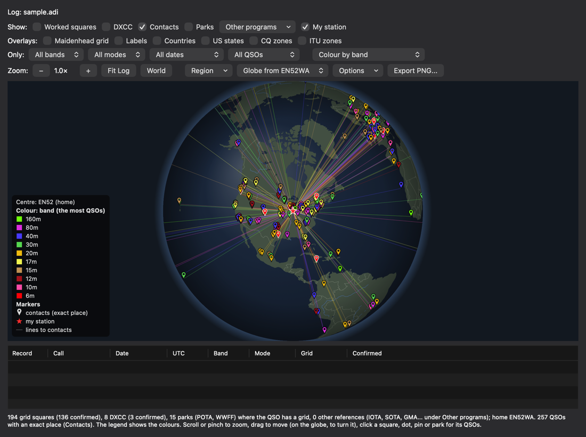
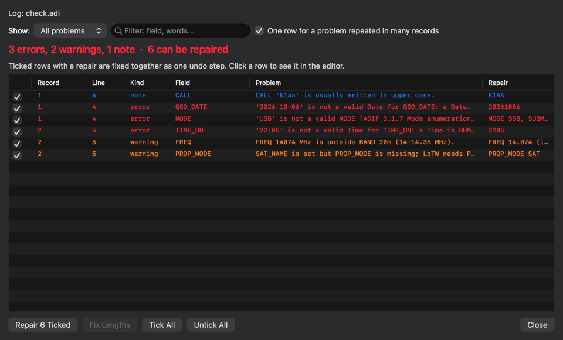
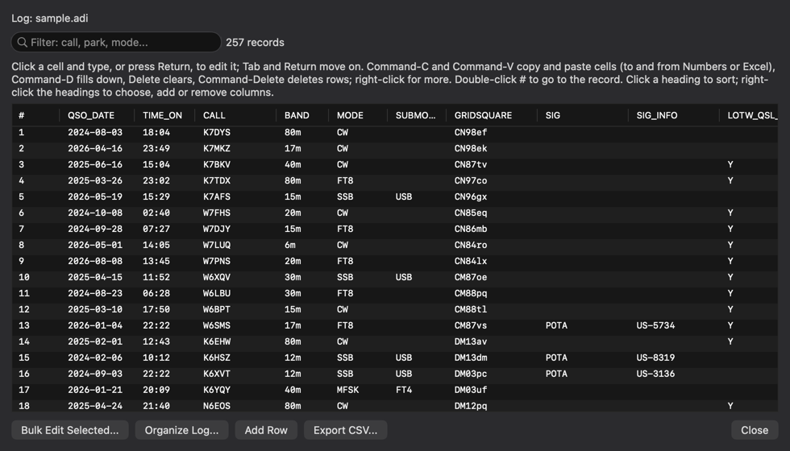
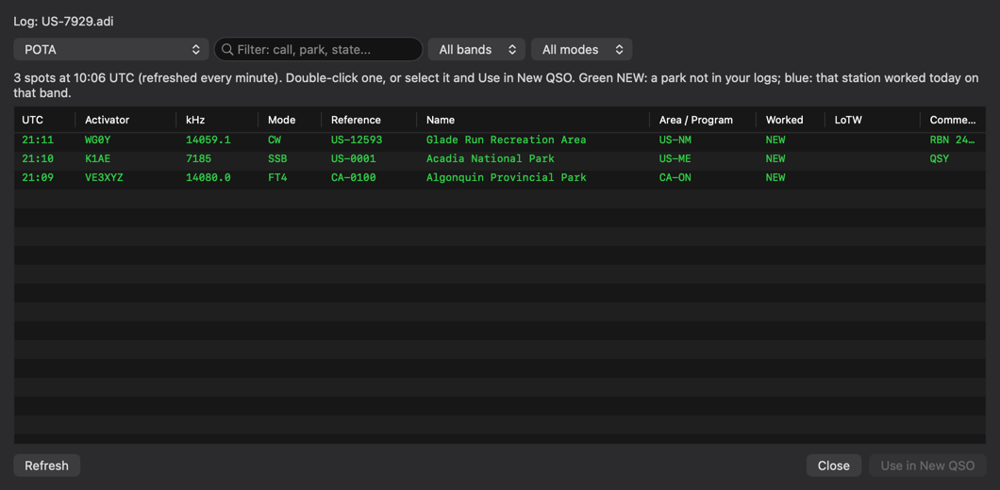
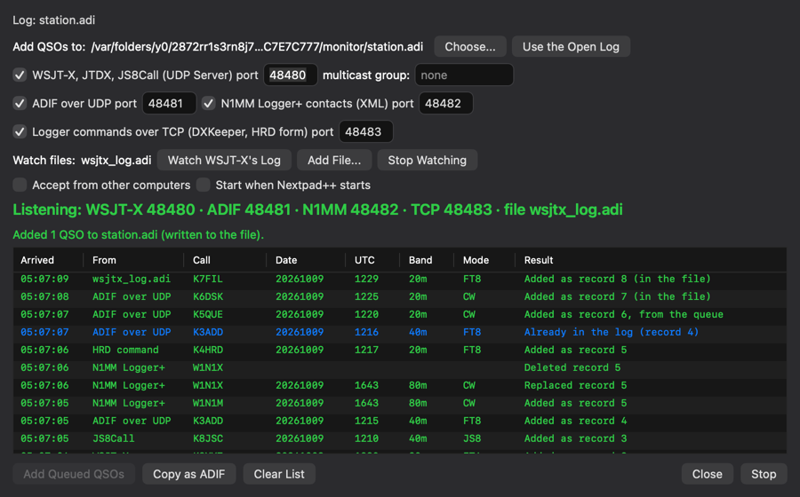
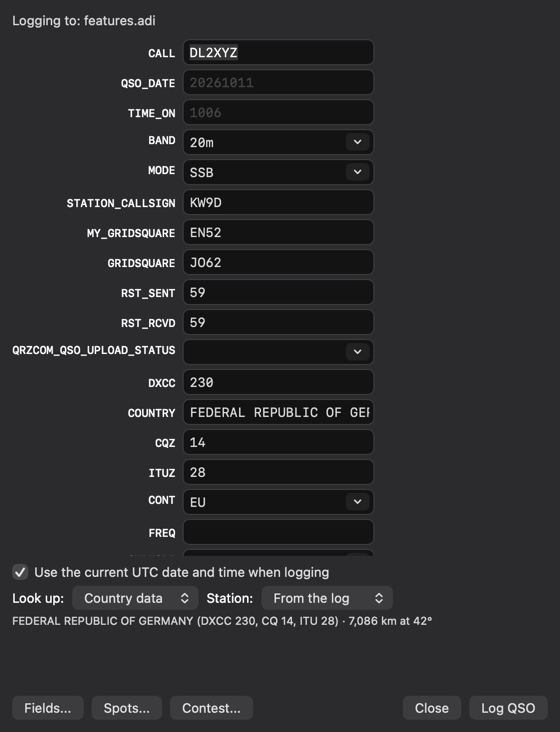
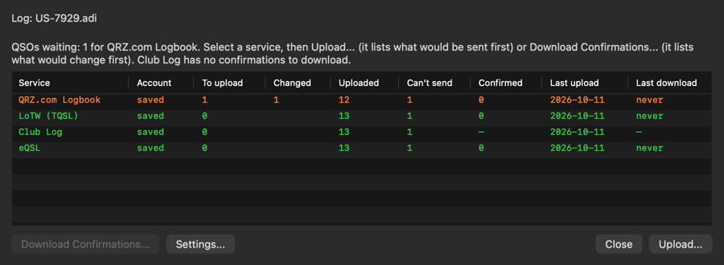
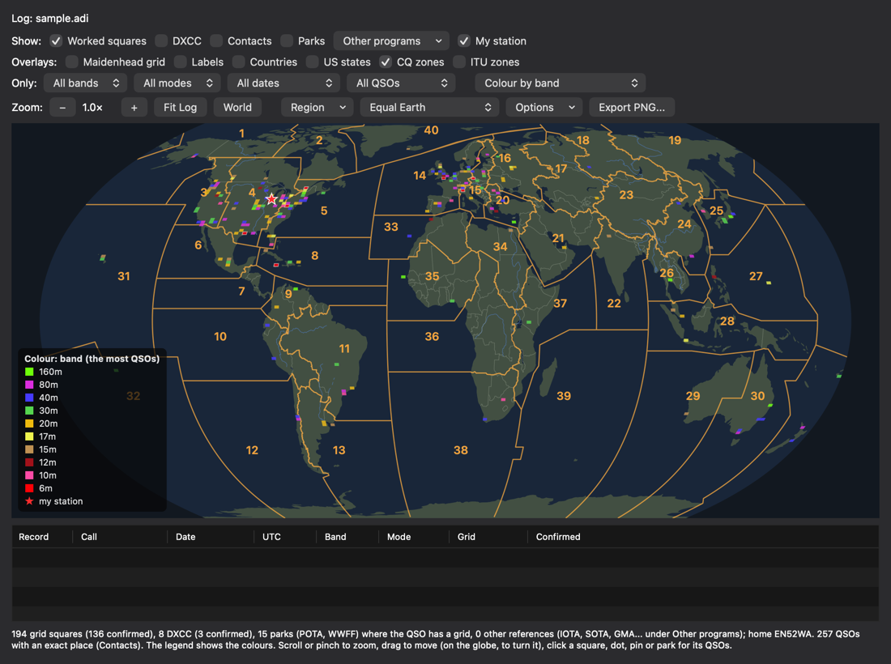
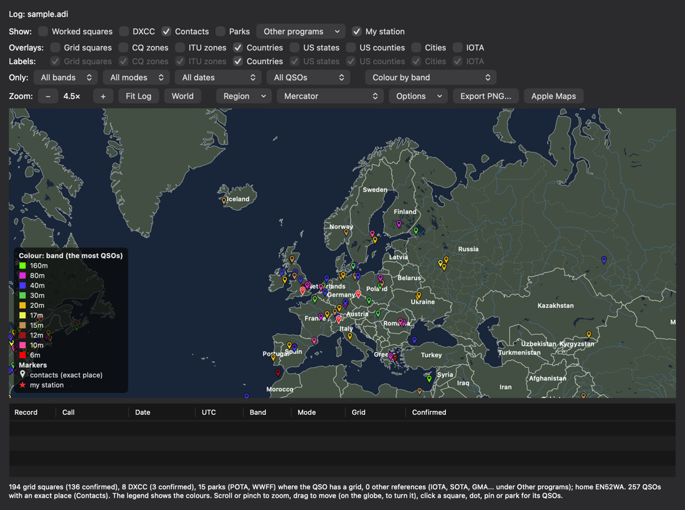

# ADIF Lint for Nextpad++ (macOS)

[](https://github.com/ssamjung2/Nextpad_plus_plus_ADIFLint/releases/latest)
[](LICENSE)


**ADIF Lint** turns [Nextpad++](https://nextpad.org) into a logbook workbench for amateur
radio. It checks [ADIF 3.1.7](https://www.adif.org/317/ADIF_317.htm) logs (`.adi`,
`.adif`) as you type and repairs them, and it adds what you need around a log: logging
contacts, POTA, WWFF and SOTA activations, spots, QSOs captured from WSJT-X and N1MM, an
offline map, and QSL sync with LoTW, QRZ.com, Club Log and eQSL.



*The Map: a globe you turn by dragging, each contact at its own place, coloured by band.*

## Highlights

- **Catches what breaks a log, and fixes it.** Every field is written `<NAME:LENGTH>data`,
  so changing `W1AW` to `W1AW/P` without changing `4` to `6` silently truncates the call,
  and most programs never say. ADIF Lint marks that, and every other ADIF 3.1.7 rule, as you
  type. **Check Log** repairs what it can in one undo step. ADIF's own 6,197-QSO test file
  lints clean.
- **Logs contacts fast.** **New QSO** carries your station's fields over, looks the call up
  (offline country data, QRZ.com or HamQTH), warns of duplicates by POTA's park-to-park
  rule, and handles contests and Field Day.
- **Makes activations easy.** **Start Activation** for POTA, WWFF or SOTA names the log the
  way the program asks, writes the activation's fields into every QSO, counts toward the
  goal ("US-7929 today: 8 of 10"), and exports the files each program wants.
- **Spots from everywhere.** POTA, WWFF and dozens more programs through Spothole, with
  parks you haven't worked marked NEW; double-click one to log it.
- **Captures QSOs from your other programs.** **Monitor** adds what WSJT-X, JTDX, JS8Call,
  N1MM Logger+, GridTracker and other loggers log, as they log it. It only listens.
- **Maps your log, offline.** A globe or a flat map with worked squares, contacts at their
  exact place, DXCC, parks, lines to contacts, distance rings, and overlays for countries,
  US states, and CQ and ITU zones. Colour by band in PSKReporter's colours, mode,
  confirmation, count or year, with a palette tested for colour blindness.
- **Keeps QSL services in sync.** Import your QSOs and confirmations from LoTW, QRZ.com
  Logbook and eQSL; upload to QRZ.com Logbook, LoTW (TQSL), Club Log and eQSL. Every window
  lists exactly what would be sent or changed, and nothing happens until you say so.
- **Edits the whole log safely.** A **Log Table** that edits like a spreadsheet, **Bulk
  Edit**, **Time Shift**, **Remove Duplicates** and **Compare and Merge Logs**, each
  previewed, each one undo step.
- **Private.** Accounts live in your macOS Keychain, every request is HTTPS and only when
  you ask, and there is no telemetry.

ADIF Lint is free software under the [GNU GPL v3](LICENSE). It is an independent project,
not affiliated with or endorsed by the Nextpad++ or Notepad++ projects.

## Screenshots

| Check Log: every problem with its repair | Log Table: a spreadsheet over the log |
|---|---|
|  |  |
| **Spots: parks not in your logs in green** | **Monitor: QSOs from WSJT-X, N1MM and loggers** |
|  |  |
| **New QSO: lookup, distance and bearing** | **QSL Sync, and the Activation Tracker** |
|  | <br><br> |
| **Map: worked squares and CQ zones** | **Map: countries and contacts** |
|  |  |

*Screenshots from the test suite, with sample data.*

## Features

**Checking and repairing**
- Problems marked as you type against the ADIF 3.1.7 specification: data lengths,
  structure, field names, data types, enumerations (BAND, MODE and SUBMODE, QSL statuses,
  STATE for the DXCC entity…), FREQ against BAND, user-defined and `APP_` fields. Hover a
  mark to read why. Every rule is listed in [ADIF conformance](docs/ADIF_CONFORMANCE.md).
- **Check Log** lists every problem with its repair, and repairs the ones you tick in one
  undo step: MODE `USB` or `FT4` (becomes MODE SSB, SUBMODE USB), dates and times typed as
  `2026-10-06` and `22:30`, FREQ in kHz, BAND missing or not matching FREQ, TX_PWR written
  `30W`, lowercase calls and states, a satellite QSO without `PROP_MODE SAT`, a POTA record
  without STATION_CALLSIGN, a repeated field, a missing final `<EOR>`, retired codes.
- **Fix Lengths** corrects every wrong `<FIELD:LENGTH>` in one undo step.
- Syntax colouring, **Reformat** (one record or one field per line, data untouched),
  autocomplete of field names and values with automatic lengths, and a docked **Record
  Panel** for the record at the caret, whose top line sums up the log (problems, QSOs
  waiting to upload, today's activation).

**Logging and activations**
- **New QSO**: your station's fields carried over (or a **station profile**), UTC date and
  time, live checks, duplicate warnings, callsign lookup with distance and bearing, what
  your logs say about the park, and LoTW users (optional).
- **Contests and Field Day**: ARRL Field Day, Winter Field Day or serial numbers, with the
  exchange asked for, duplicates warned by the contest's rule, and Cabrillo.
- **Start Activation** and the **Activation Tracker** for POTA, WWFF and SOTA, each with
  its own rule, and **Export Activation Logs** with each program's file names.
- **Spots** from POTA, WWFF and, through [Spothole](https://spothole.app), GMA, WWBOTA,
  IOTA, castles, lighthouses and dozens more.
- **Monitor**: QSOs from WSJT-X, JTDX, JS8Call, N1MM Logger+, GridTracker (to DXKeeper,
  HRD, N1MM or Log4OM) or any program that sends ADIF over UDP go to the log you choose:
  into the open log, into the file when it's closed, or queued while it's in another tab.
  It can also watch WSJT-X's log file.

**Log tools**
- **Log Table**: sort, filter, type into cells, copy and paste with Numbers or Excel, fill
  down, add and delete rows, add or remove a field as a column.
- **Bulk Edit** (set, replace, change case, remove, rename; filter by 12 kinds of match),
  **Time Shift** (local time to UTC, daylight saving included), **Sort and Organize**,
  **Remove Duplicates** and **Compare and Merge Logs**, each previewed before it changes
  anything.
- **Log Summary**, **Worked Before** across a folder of logs, **Import CSV**, **Export
  CSV**, **Export Cabrillo**, and **QSL labels** on Avery sheets.

**The Map**
- A **globe** you turn by dragging, or Equirectangular, Mercator or Equal Earth; zoom in
  for detail, or jump to a continent with **Region**.
- **Worked squares**, **Contacts** at their exact place (LAT/LON or a 6-character grid,
  ignoring QRZ.com's placeholders), **DXCC**, **parks** and other programs' references,
  **lines to contacts** and **distance rings**.
- Overlays: the **Maidenhead grid**, **countries**, **US states**, **CQ zones** and **ITU
  zones**, each named where it fits.
- **Colour by** confirmation, band (PSKReporter's colours), mode, QSO count or year, with
  a legend; palettes include **Colour-blind safe** (tested under simulated colour blindness)
  and **Light** for printing. **Export PNG** saves what you see.

**Online services**
- **Import** your QSOs and confirmations from LoTW, QRZ.com Logbook or eQSL, after you
  review every change.
- **Enrich** missing fields from QRZ.com, HamQTH or offline country data.
- **QSL Sync** and **Upload** to QRZ.com Logbook, LoTW (through TQSL, with a pre-flight
  check against your Station Location), Club Log and eQSL, keeping the ADIF upload-status
  fields up to date.

**Command line**
- `adiflint` runs the same checks and log tools in a terminal.

Every window and option is described in the [user guide](docs/USER_GUIDE.md).

## Requirements

- macOS 11 or later, on Apple silicon or Intel (the plugin is universal).
- Nextpad++ for Mac 1.1.2 or later.
- Optional: TQSL for LoTW uploads, and accounts with the online services you use.

## Install

**From a release.** Download `ADIFLintvX.Y.Z.zip` from
[Releases](https://github.com/ssamjung2/Nextpad_plus_plus_ADIFLint/releases/latest), unzip
it, move the `ADIFLint` folder into `~/Library/Application Support/Nextpad++/plugins/`,
and restart Nextpad++. The release is ad-hoc signed, not notarized. If Nextpad++ won't load
it after a browser download, clear the download's quarantine flag:

```bash
xattr -dr com.apple.quarantine ~/Library/Application\ Support/Nextpad++/plugins/ADIFLint
```

**From Plugins Admin.** ADIF Lint has been submitted to the Nextpad++ plugin list. Once it
is accepted, it will install from **Plugins → Plugins Admin**.

**From source.** With the Xcode command-line tools and CMake 3.20 or later:

```bash
cmake -B build -DCMAKE_BUILD_TYPE=Release
```

```bash
cmake --build build -j
```

```bash
cmake --install build
```

The install step copies the plugin into the folder above. It writes a new file and renames
it into place, so it is safe while Nextpad++ is running; restart Nextpad++ to load it.

To uninstall, quit Nextpad++ and delete the `ADIFLint` folder.

## Getting started

1. Open an `.adi` file. Problems are marked within half a second; rest the mouse on a mark
   to read it.
2. **Plugins → ADIF Lint → Check Log…** lists every problem and repairs what it can;
   **Fix Lengths** repairs the data lengths.
3. **New QSO…** starts logging. The first time, Settings asks for your callsign and grid.
4. **Map (Grids, DXCC, Parks)…** shows the log on a world map; choose **Globe** in the
   projection pop-up and drag to turn it.
5. To use an online service, add your account in **Settings…** first.

The source repository has [`examples/try-me.adi`](examples/try-me.adi), with one of each
kind of mistake.

## Menu

All commands are under **Plugins → ADIF Lint**. Nextpad++ ignores plugin default
shortcuts, so assign your own in Nextpad++'s **Edit → Shortcut Mapper…** (Plugin commands
tab); Settings suggests some.

| Command | Does |
|---|---|
| New QSO… | Log contacts one after another |
| Spots (POTA, WWFF, More)… | Activators spotted now, from POTA, WWFF, or Spothole for GMA, WWBOTA, IOTA and dozens more; pick one to fill New QSO |
| Start Activation… | A POTA, WWFF or SOTA activation: a new log, your station profile and the activation's fields in every QSO; Finish checks and exports |
| Log Table… | The log as a spreadsheet: sort, filter, edit, copy and paste, add and delete rows and columns |
| Check Log… | Every problem in one list, with its repair; repair the ticked ones in one step |
| Fix Lengths | Correct every data length |
| Next Problem / Previous Problem | Move between marks |
| Bulk Edit… | Set, replace, remove or rename a field, or fill DISTANCE, with a preview |
| Time Shift… | Convert times between UTC and a time zone, or shift by a fixed amount |
| Sort and Organize… | Sort the records (by date and time in one click, or by any fields), and put every record's fields in one order |
| Remove Duplicates… | Find QSOs logged twice and remove them after review |
| Compare and Merge Logs… | Compare with another log: add the QSOs only it has, copy the fields this log lacks |
| Log Summary… | Counts by band, mode, day, entity and park; confirmations and uploads |
| Activation Tracker (POTA, WWFF, SOTA)… | Activations counted by each program's rule |
| Worked Before… | Search a folder of logs for a call |
| Map (Grids, DXCC, Parks)… | The log on a world map: worked squares, DXCC, parks and other programs, coloured by confirmation, band, mode, count or year; contacts at their exact place; countries, US states, CQ zones and ITU zones; four projections, including a globe you turn by dragging; paths and distance rings; PNG export |
| Import… | From LoTW, QRZ.com Logbook or eQSL (your QSOs and confirmations), a CSV file, or WSJT-X's log |
| Export… | Activation logs for POTA, WWFF or SOTA, CSV, a Cabrillo contest log, or QSL labels (PDF) |
| QSL Sync (Upload, Confirmations)… | Each service at a glance; upload to QRZ.com Logbook, LoTW (TQSL), Club Log or eQSL (list what would be sent, upload when you say so, mark it uploaded) and download confirmations |
| Enrich… | Fill missing station details from QRZ.com or HamQTH, or DXCC, zones and continent from country data (offline) |
| Monitor (WSJT-X, N1MM, Loggers)… | Add the QSOs WSJT-X, JS8Call, N1MM Logger+, GridTracker and other programs log to a log you choose, as they log them |
| Record Panel | Show or hide the docked record table |
| Reformat: One Record per Line / One Field per Line | Re-lay the file without touching data |
| Check .adi Files While Typing | Problem marks as you type (on by default) |
| Settings… | Your station, editor options, country data, and accounts for the online services |
| About ADIF Lint… | Version, licence and links |

Import…, Export… and Enrich… open the window you used last; the popup at its top switches to
the others. QSL Sync opens each upload window. The toolbar gets buttons for New QSO, Log Table, Check Log and
Spots.

Every command that changes the log is one undo step, and nothing is saved until you save
the file.

## Privacy and network

ADIF Lint only goes online when you use a command that needs it, and every request uses
HTTPS.

| Service | Address | When | What is sent |
|---|---|---|---|
| QRZ.com XML | `xmldata.qrz.com` | Enrich (QRZ.com); New QSO lookup set to QRZ.com; Test Sign-In | Your username and password (POST), then the calls looked up |
| HamQTH | `www.hamqth.com` | Enrich (HamQTH); New QSO lookup set to HamQTH; Test Sign-In | Your username and password, then the calls looked up |
| LoTW | `lotw.arrl.org` | Import (LoTW); Test Sign-In | Your username and password and the log's date range |
| QRZ.com Logbook | `logbook.qrz.com` | Upload and Import (QRZ.com Logbook); Test Sign-In | Your API key, the log's date range and the QSOs you upload |
| Club Log | `clublog.org` | Upload (Club Log) | Your email, Application Password, API key and the QSOs you upload |
| eQSL | `www.eqsl.cc` | Upload and Import (eQSL) | Your username and password, the log's date range and the QSOs you upload |
| POTA | `api.pota.app` | The Spots window (POTA), every minute while it is open | Nothing but the request |
| WWFF | `spots.wwff.co` | The Spots window (WWFF), every minute while it is open | Nothing but the request |
| Spothole | `spothole.app` | The Spots window (More programs), every 2 minutes while it is open | The programs asked for (never a login) |
| Country files | `www.country-files.com` | Settings → Country Data → Update | Nothing but the request |
| LoTW user list | `lotw.arrl.org` | Settings → LoTW Users → Update, and weekly while it is on | Nothing but the request |

- **Credentials** are stored only in your macOS Keychain ("ADIF Lint: …" items), never in
  a file, and a saved password is never shown again. HamQTH's sign-in, LoTW's report API
  and eQSL's DownloadInBox take the login in the HTTPS address, as those services document
  it.
- **TQSL** runs on your Mac for LoTW uploads. A certificate password you save is passed on
  its command line, where other programs on your Mac could see it while TQSL runs.
- **Monitor** listens and never sends: on the UDP and TCP ports you tick, on `127.0.0.1`
  only unless you tick Accept from other computers. It writes only to the log you chose and
  to its queue file in the plugin config folder.
- **Settings** are kept in `ADIFLint.ini` in Nextpad++'s plugin config folder
  (`~/Library/Application Support/Nextpad++/plugins/Config/`).

See [SECURITY.md](SECURITY.md) to report a security problem.

## Command line

`build/adiflint` checks files from a terminal and prints `file:line:column: severity:
message`; the exit status is 1 when there are errors.

```bash
build/adiflint examples/try-me.adi
```

It can also fix lengths, repair every problem with a known repair (`--fix-all`), reformat, sort (by date and time or by any fields), put fields in
order, remove duplicates, convert to and from CSV, print the summary, and write Cabrillo or
activation files. `build/adiflint --help` lists the
options, and the [user guide](docs/USER_GUIDE.md#command-line) describes them.

## Building and testing

```bash
cd build && ctest --output-on-failure
```

The tests check every validation rule against the ADIF specification and the official
ADIF test file, fuzz the parsers, and drive the built plugin through every window against
a simulated Nextpad++, with saved sample replies in place of the online services.
[CONTRIBUTING.md](CONTRIBUTING.md) covers the build, the tests, the project layout
and the release steps.

## Limits

- Nextpad++ doesn't let plugins supply a lexer or write to the status bar, so colours are
  painted for the lines on screen, and summaries appear in a tip at the caret.
- Only the active document is checked.
- The online services were tested against saved sample replies, not the live services.
- No SOTA spots: the SOTA API's terms don't allow software written with AI tools without
  the SOTA team's approval. SOTA tracking and export work offline.
- Club Log offers no documented way to download QSOs or confirmations, so there is no
  Import from Club Log. eQSL documents only its InBox (the eQSLs others sent you), so Import
  from eQSL offers the QSOs your log lacks without ticking them: they are the other
  station's records.
- ADX (XML) files are not handled.

The [user guide](docs/USER_GUIDE.md#limits) lists the rest.

## Documentation

- [User guide](docs/USER_GUIDE.md): every window, option and rule.
- [Changelog](CHANGELOG.md): what changed in each version.
- [Contributing](CONTRIBUTING.md): building, testing and releasing.
- [Security](SECURITY.md): reporting a problem, and how your data is handled.

## Licence and credits

ADIF Lint is licensed under the [GNU General Public License v3](LICENSE), the licence of
Nextpad++ and its plugins.

- The validation tables and field descriptions are generated from the
  [ADIF 3.1.7 specification](https://www.adif.org/317/ADIF_317.htm) and its JSON export,
  published by the ADIF Development Group for developers.
- `data/cty.csv` is Jim Reisert AD1C's [Big CTY](https://www.country-files.com/) country
  file, under the MIT licence ([`data/cty-copyright.txt`](data/cty-copyright.txt)).
- The Map draws [Natural Earth](https://www.naturalearthdata.com)'s land, lakes, rivers,
  borders, countries and US states (public domain), and CQ and ITU zones from HB9HIL's
  [hamradio-zones-geojson](https://github.com/HB9HIL/hamradio-zones-geojson) under the MIT
  licence ([`data/zones-license.txt`](data/zones-license.txt)); see
  [`data/SOURCE.md`](data/SOURCE.md). Colour by band uses
  [PSKReporter](https://pskreporter.info)'s band colours.
- `third_party/` holds the Nextpad++ plugin header (GPL v3) and the Scintilla headers
  (Scintilla licence); see [`third_party/README.md`](third_party/README.md).
- HamQTH data is credited in the Enrich window, as HamQTH asks.

Nextpad++ and Notepad++ are the names of their respective projects. QRZ.com, LoTW, Club
Log, eQSL, POTA, WWFF and SOTA are the names of their services and programs; ADIF Lint is
not affiliated with any of them.
